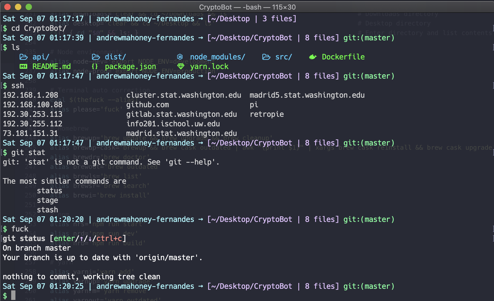

## Custom Zsh Configuration



### 📄  Configuration Files

- [`~/.zshenv`](./zshenv)  \n  Sourced for EVERY zsh (login, interactive, AND non-interactive `zsh -c`). Minimal — only what must be on PATH for non-interactive contexts (e.g. cargo for build tools).

- [`~/.zprofile`](./zprofile)  \n  Loads terminal settings, exports, and paths on login shells.

- [`~/.zshrc`](./zshrc)  \n  Contains functions, aliases, and settings applied to interactive non-login shells.

- [`~/.profile`](./profile)  \n  Minimal POSIX login profile for `/bin/sh` and bash; just cargo's env. zsh does not read it.

- [`~/.config/mise/config.toml`](./mise/config.toml)  \n  Global mise pins for all dev runtimes and CLIs; symlinked from this repo.

### 🔗 Install as the global configuration

From this repository, link the managed files into your home directory:

```sh
ln -sfn "$PWD/zshenv" "$HOME/.zshenv"
ln -sfn "$PWD/zprofile" "$HOME/.zprofile"
ln -sfn "$PWD/zshrc" "$HOME/.zshrc"
ln -sfn "$PWD/profile" "$HOME/.profile"
mkdir -p "$HOME/.config/mise"
ln -sfn "$PWD/mise/config.toml" "$HOME/.config/mise/config.toml"
```

The active machine uses these links, so future changes should be made in this repository rather than in `$HOME`.

### 🧭 Shared Config Rules

- Put all PATH entries, environment exports, and machine-added CLI bootstrap in [`zprofile`](./zprofile) using `add_to_path`; never modify PATH in `zshrc`.
- Keep prompt logic, aliases, and interactive shell functions in [`zshrc`](./zshrc).
- Use generic references such as `$HOME`; never commit username-specific absolute paths like `/Users/your-name/...`.
- Keep machine-specific hosts and usernames as environment variables such as `PI_SSH_TARGET`, and edit shared files directly when needed.

### 🔧  Helpful Tools

- [Homebrew](https://brew.sh/) - Package manager for macOS.
- [mise](https://mise.jdx.dev/) - Single source of truth for dev runtimes (Java/Node/Python/Bun) and dev CLIs including npm CLIs via its `npm:` backend. Homebrew handles system packages; there are no global npm/bun installs. Pins live in the repo's [`mise/config.toml`](./mise/config.toml), symlinked to `~/.config/mise/config.toml`.
- [jEnv](https://github.com/jenv/jenv) - Java environment manager
- [eza](https://github.com/eza-community/eza) - Modern Rust `ls` replacement (replaces colorls)
- [Dracula Theme](https://draculatheme.com/terminal/) - Dark and beautiful theme capatible with bash
- [zsh-users](https://github.com/zsh-users) - Collection of powerfull Zsh plugins such as autosuggestions, syntax-highlighting, and completions
- [thefuck](https://github.com/nvbn/thefuck) - Console command error corrector
- [cointop](https://github.com/miguelmota/cointop) - Interactive terminal based UI application for tracking cryptocurrencies
- [dockly](https://github.com/lirantal/dockly) - Docker console UI Dashboard for quickly managing and inspecting Containers
- [howdoi](https://github.com/gleitz/howdoi) - Instant code answers and examples from the command line
- [wttr.in](https://github.com/chubin/wttr.in) - Weather console app
- [fx](https://github.com/antonmedv/fx) - Command-line tool and terminal JSON viewer
- [rebound](https://github.com/shobrook/rebound) - Command-line tool that instantly fetches Stack Overflow results when an exception is thrown
